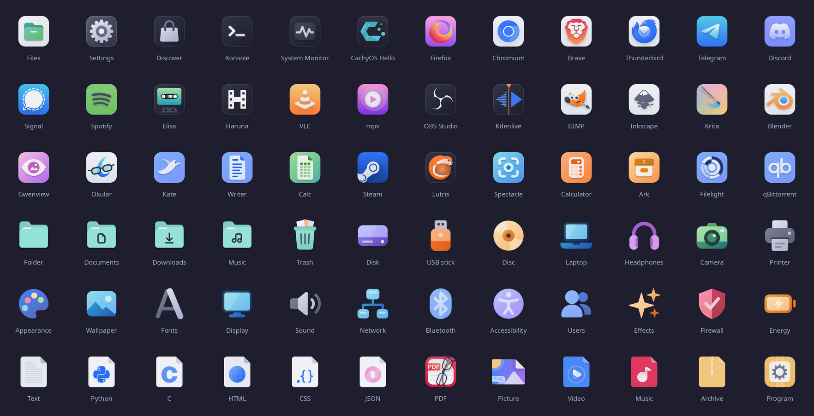

# Teal

An icon theme in the [Catppuccin](https://catppuccin.com) Mocha colors with a teal accent
and [Papirus](https://github.com/PapirusDevelopmentTeam/papirus-icon-theme)'s system icons. It is the companion of
[Lagoon](https://github.com/elomkdn/lagoon-kde), a KDE Plasma theme, and looks at home in any
dark desktop.



- **Apps**: icons in the style of macOS's, recolored with Catppuccin: each app
  keeps its hue, in Latte and Mocha shades. Teal is kept for the system (folders, files,
  settings, software center), so it still means something.
- **Their own tiles**: each app keeps its colored or light tile; the apps that would only
  have a generic or borrowed icon get one drawn for Teal, and the apps with a logo of their
  own (KDE Connect, Gwenview, the Qt and CachyOS tools…) show that logo, in Catppuccin
  colors, on a Mocha tile. Round logos (Kate, Faugus, Micro) lose their disc, whose color becomes
  the tile. A dark tile is always the same one, Mocha's.
- **The system and the hardware**: System Settings' pages and the hardware (drives, cards,
  headphones, microphones, cameras, printers…) are objects without a tile, each in its own
  pastel. In Plasma's own panels and popups (Bluetooth, volume, battery, disks), the hardware
  is monochrome, like the system's icons around it.
- **File types**: text and code files are sheets of paper, with the language's mark in its
  color; pictures, music, videos and archives keep a page of their own color.
- **System icons**: Papirus Dark's action, status and tray icons, in Mocha colors (Mocha text
  instead of Papirus's gray, teal instead of its blue, Catppuccin red, yellow and green for
  states).
- **The tray**: Papirus's icons for the system (network, battery, sound, notifications…);
  apps keep their own, except Spotify, in monochrome. Apps that send a picture rather than an
  icon's name, like qBittorrent, cannot be themed: its monochrome icon is in its own options.

## Install

- **A clone of the repository**: the installer builds the theme first, and needs
  Papirus for it (`sudo pacman -S papirus-icon-theme`).

  ```bash
  git clone https://github.com/elomkdn/teal-icons.git
  cd teal-icons
  ./install.sh --set
  ```

- **A release archive**: download `teal-icons.tar.gz` from the
  [releases](https://github.com/elomkdn/teal-icons/releases), extract it, run the installer.
  The theme is built, Papirus's system icons included: it installs offline, with nothing
  else.

  ```bash
  tar -xzf teal-icons.tar.gz
  cd teal-icons
  ./install.sh --set
  ```

| Command | Effect |
|---|---|
| `./install.sh` | installs `Teal` into `~/.local/share/icons` |
| `./install.sh --set` | and selects it |
| `./install.sh --uninstall` | removes it |

Either way, with Python (there on CachyOS), Teal is made at home on your computer: the
apps you have installed show their own logos and tray icons, and Papirus, if installed,
covers the icons Teal does not have. The logos given as pictures need `python-pillow`;
without it, Teal's drawings stay. Run the installer again after installing such apps.

## How it is made

- `make/generator/catppuccin.py` recolors an icon: each color goes to the Catppuccin color
  of the same hue, from Latte (its dark shades) to Mocha (its light ones); grays follow one
  ramp from Mocha's crust to Latte's base.
- `make/teal/draw.py` draws Teal's own icons when the theme is built, on a macOS-like grid (a
  56 px tile with 13 px corners on a 64 px canvas, lit from above): `shapes.py` holds the
  shapes, `draw.py` says which icon gets which, `logos.py` puts an app's own logo on a tile.
- `make/catppuccin-theme.py` builds the theme from its base icons (`install-base.sh`):
  recolors them, gives the dark tiles Mocha's and the code files their paper, places the
  drawn icons, copies Papirus's system icons. `dist.sh` makes the release archive with them.
- `make/sheet.py` checks the pack against `make/RULES.md`; `make/preview.py` draws the
  picture above from the built theme.
- `make/localize.py` makes it at home on each computer: the apps' logos (read from the
  system, never copied into this repository), their tray icons, Papirus as the fallback.

## Credits

Teal is a derivative work of:

- [Adwair](https://github.com/kusaida/Adwair) by kusaida — GPL-3.0, itself based on
  [WhiteSur](https://github.com/vinceliuice/WhiteSur-icon-theme) by vinceliuice,
  [Hatter](https://github.com/Mibea/Hatter) by Mibea,
  [MoreWaita](https://github.com/somepaulo/MoreWaita) by somepaulo (GPL-3.0) and the
  [Adwaita icon theme](https://gitlab.gnome.org/GNOME/adwaita-icon-theme) by the GNOME
  Project (LGPL-3.0);
- [Papirus](https://github.com/PapirusDevelopmentTeam/papirus-icon-theme) by the Papirus
  Development Team — GPL-3.0, its system icons, copied at build time;
- the [Catppuccin](https://github.com/catppuccin/palette) palette — MIT.

The apps' logos belong to their projects; Teal only reads them from your system.

Teal is an independent project: it is not made by, nor endorsed by, the projects above or
CachyOS.

## License

[GPL-3.0](LICENSE).
